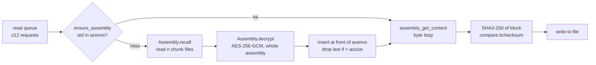
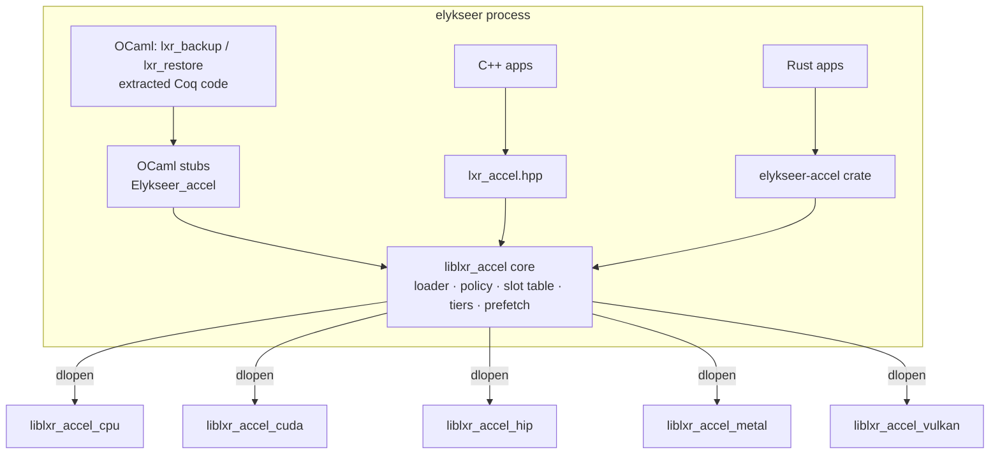

[Content](00_Content.md)

# AssemblyCache in GPU memory — design study

Status: **proposal / discussion**. Nothing in this document is implemented yet. All performance
numbers are *estimates* derived from first principles and typical hardware figures; Phase 0 of the
[roadmap](#11-roadmap) exists to replace them with measurements.

---

## 0. Summary

* Every read from and write to a plain assembly is a **byte-level transpose** (see §1). The
  current C++ loop does this one byte at a time with two 64-bit divisions per byte and a
  power-of-two stride of 256 KiB. That is slow (estimated 0.3–0.6 GB/s) — but it is slow on the
  CPU *because of how it is written*, not because the CPU is the wrong device.
* On the **warm path** (assembly already decrypted) a restore can become **20–50× faster** than
  today. Most of that gain is reachable with an optimised **CPU backend** (tiled SIMD transpose,
  multi-threading, parallel SHA3-256 verification).
* A discrete GPU then adds roughly **1–2×** on the data path itself, because the result has to
  cross PCIe. Per single 32 KiB request it is **slower** than the CPU unless requests are
  batched.
* Where the GPU really pays off:
  1. **Capacity** — VRAM is an extra, otherwise idle memory tier. 16 GB of VRAM keeps ~250
     decrypted 64 MiB assemblies hot, each one saving 35–45 ms (local chunks) up to seconds
     (remote sinks) of recall + decryption on every cache miss.
  2. **CPU offload** — SHA3 verification and transposes move off the CPU, which stays free for
     AES-GCM, compression and I/O.
  3. **Apple M\*** — unified memory: no copies at all, the GPU works directly on the buffer.
* VRAM **cannot** be protected the way host memory can (no `mlock`, no page permissions you
  control; on some platforms it gets evicted to host RAM or swap). A **sealed mode** that keeps
  VRAM content encrypted under an ephemeral session key and decrypts inside the read kernel is
  proposed. Hardware-protected VRAM only exists on datacenter GPUs in confidential-computing mode.
* Architecture: a small **C ABI** (`lxr_accel.h`), one **plug-in shared library per backend**
  (CPU, CUDA, HIP, Metal, Vulkan), a loader that probes the hardware at start-up, and user
  overrides for backend, device, memory budget and security mode. Thin bindings for C++, OCaml
  and Rust.
* **Recommendation:** build the plug-in architecture and the CPU backend first; add GPU backends
  only once the Phase 0 benchmarks show they beat it on real workloads.

---

## 1. How the code works today

### 1.1 Sizes

| item | value | source |
|---|---|---|
| chunk | 256 × 1024 B = **256 KiB** | `theories/Assembly.v` (`chunkwidth`, `chunklength`) |
| chunks per assembly `n` | 16 … 256 | `theories/Nchunks.v` |
| assembly | `n × 256 KiB` = **4 MiB … 64 MiB** | `Assembly.assemblysize` |
| file block | ≤ 32 KiB | `theories/Processor.v` (`block_sz`) |
| GCM tag | 16 B, last bytes of the last chunk | `theories/Cstdio.v` (`tag_len`) |
| random header | ≤ 128 B at the start | `AssemblyPlainWritable.create` |
| read/write queue length | 12 | `theories/AssemblyCache.v` (`qsize`) |

### 1.2 Striping — why the data is "non-local"

`elykseer-base/assembly.cxx`:

```c++
inline long idx2apos (long idx, long nchunks) {
    long cnum = idx % nchunks;      // which chunk
    long cidx = idx / nchunks;      // offset inside the chunk
    return cnum * clength + cidx;
}
```

Seen as a matrix, the plain assembly buffer is stored **row-major** as `n` rows (chunks) of
262 144 columns, but the logical byte stream runs **column-major**:

```
              offset in chunk (cidx) →
             0      1      2      3    …  262143
chunk 0   [  0  ][  n  ][ 2n  ][ 3n  ] …
chunk 1   [  1  ][ n+1 ][2n+1 ][3n+1 ] …
chunk 2   [  2  ][ n+2 ][2n+2 ][3n+2 ] …
  …
chunk n-1 [ n-1 ][2n-1 ][3n-1 ][4n-1 ] …
             ↑ logical bytes 0…n-1 live in the same column, 256 KiB apart in memory
```

Reading a 32 KiB block at logical position `p` therefore touches `n` rows, each with a short run of
`32768 / n` contiguous bytes (2 KiB for `n=16`, 128 B for `n=256`): a **transpose of a
`n × (len/n)` sub-matrix**.

Note: the striping is a fixed, public permutation. It spreads every file over all chunks (good for
distribution to several sinks) but provides **no confidentiality** on its own.

### 1.3 Read path (restore)



* `acenvs` is a Coq list of decrypted environments, most recently used first, bounded by
  `acsize` (`theories/AssemblyCache.v`, `ensure_assembly`).
* A miss costs: read `n` chunk files + one AES-GCM decryption over the full assembly
  (all-or-nothing: the tag is only checked at the end).
* Every block is verified with SHA3-256 (`Assembly.restore` → `calc_checksum` →
  `Elykseer_crypto.Sha3_256.buffer`).

### 1.4 Write path (backup)

`EnvironmentWritable.backup` → `Assembly.backup` → `assembly_add_content` scatters the block into
the striped writable buffer. When it is full: `finalise_assembly` → `Assembly.encrypt` (AES-GCM)
→ `Assembly.extract` writes the `n` chunk files.

---

## 2. Speed-up estimate

### 2.1 Assumptions

* Assembly of 64 MiB (`n = 256`), the worst case for locality.
* CPU: current x86-64 or Apple M core, AES-NI/VAES or ARMv8 crypto; local NVMe ~3 GB/s.
* dGPU: PCIe 4.0 x16, ~25 GB/s effective per direction; VRAM bandwidth 300–1000 GB/s.
* Kernel launch + small DMA round trip ≈ 10–20 µs.

### 2.2 Per-stage costs (estimates)

| stage (64 MiB) | today | optimised CPU 1 core | optimised CPU 8 cores | dGPU (PCIe 4) | Apple M (unified) |
|---|---|---|---|---|---|
| recall chunks, local NVMe | ~20 ms | ~20 ms | ~20 ms | ~20 ms | ~20 ms |
| AES-GCM decrypt (single stream) | 15–25 ms | 15–25 ms | 15–25 ms | CPU | CPU |
| upload to device | – | – | – | ~3 ms (overlapped) | 0 |
| gather / linearise | **100–250 ms** | 5–10 ms | 1–3 ms | 0.1–0.3 ms | 0.5–1 ms |
| SHA3-256 verification | **60–130 ms** | 60–130 ms | 10–20 ms | 1–3 ms | 2–5 ms |
| result back to host | – | – | – | ~3 ms | 0 |

Why today's gather is slow: two 64-bit integer divisions per byte (`%` and `/` by a runtime
`nchunks`), and a 256 KiB power-of-two stride that maps all `n` rows onto the same L1/L2 cache
sets and touches `n` pages for every `n` bytes. A tiled transpose (e.g. 16×16 or 32×32 byte tiles
with SIMD shuffles) removes both problems.

### 2.3 What that means

| scenario | today | optimised CPU (8 cores) | dGPU | Apple M |
|---|---|---|---|---|
| warm: full assembly from cache | 160–380 ms | 12–25 ms | 5–8 ms | 3–6 ms |
| cold: + recall + decrypt | 200–420 ms | 50–70 ms | 40–50 ms | 40–50 ms |
| single 32 KiB block, warm | ~100 µs | 3–5 µs | 15–25 µs | 10–15 µs |

* **vs today:** 20–50× on the warm path, 4–8× cold.
* **dGPU vs optimised CPU:** 1–2× on bulk data, *slower* for single small requests → batching is
  mandatory (§6.3).
* **Capacity effect:** if the working set is `W` assemblies and the host cache keeps `acsize` of
  them, every access beyond that is a cold miss. With a VRAM tier of 250 assemblies, a restore that
  revisits assemblies (deduplicated data, many small files spread over many assemblies, repeated
  restore drills) saves 35–45 ms per avoided miss locally and far more for remote sinks. For such
  workloads the end-to-end gain can be **5–20×** over the optimised CPU with a small cache.
* Honest caveat: a large **host-RAM** tier gives the same capacity effect when RAM is plentiful.
  The GPU is worth it when RAM is needed elsewhere, when the CPU is the bottleneck (SHA3 + AES +
  compression), or on unified-memory machines.

---

## 3. Data layout

### 3.1 Device memory: a slab of chunk-sized pages

At start-up the backend allocates **one** region of the user's budget and splits it into pages of
**256 KiB** — exactly one chunk. Every assembly size is a whole number of pages, so assemblies with
different `n` (the per-key `localnchunks` may differ from the configured value) share the pool
without fragmentation.

```
VRAM budget
┌────┬────┬────┬────┬────┬────┬────┬────┬─────────────┐
│ p0 │ p1 │ p2 │ p3 │ p4 │ p5 │ p6 │ p7 │ …  free list │
└────┴────┴────┴────┴────┴────┴────┴────┴─────────────┘
slot table (device + host mirror):
  slot 3: aid=…a91f  n=16   pages=[p0,p5,p2,…]  layout=L  state=READY  lru=…
  slot 7: aid=…07c2  n=256  pages=[p1,p3,…]     layout=L  state=LOADING
```

* Slot table entry: `aid` (32 B), `n`, page list (≤ 256 × u32), layout, state
  (`FREE/LOADING/READY/WRITABLE/EVICTING`), LRU stamp, cost class (local / remote), pin count.
* Optional per-slot nonce for sealed mode (§4.3).
* Staging: a few pinned host buffers (2 × 64 MiB) for double-buffered uploads/downloads, and one
  device scratch assembly for out-of-place transposes.

### 3.2 Layout L — linearise on load (recommended)

Upload the striped plaintext into scratch, run one transpose kernel into the slot's pages so that
page `k` holds logical bytes `[k·256 KiB, (k+1)·256 KiB)`.

* Cost: one in-VRAM transpose per load (0.1–0.3 ms for 64 MiB).
* Reads: a 32 KiB block spans at most 2 pages → 1–2 contiguous copies, or one batched gather
  kernel into a pinned output buffer followed by **one** DMA.
* No security cost: the striping is public (§1.2).

### 3.3 Layout S — keep the striping (alternative)

Pages hold chunks as on disk; every read runs a tiled transpose:
each work-group loads an `n × T` tile with coalesced row reads into shared/threadgroup memory and
writes it out column-wise. Useful if loads dominate reads (e.g. scanning many assemblies once).
The backend can expose both; Phase 0 decides the default.

### 3.4 Write path layout

The writable assembly lives as a **linear** staging buffer (host pinned, or a device slot):
`add_content` becomes an append (`memcpy`). At `finalise`, one bulk *stripe* transpose (inverse of
§3.2) produces the on-disk order, which is downloaded (dGPU) and encrypted on the CPU. The archive
format does not change. Optionally the plaintext stays in T0 as a warm slot for a
verify-after-backup pass.

### 3.5 Tiers

| tier | content | eviction | notes |
|---|---|---|---|
| T0 VRAM | decrypted assemblies, layout L | cost-aware LRU, user budget | sealed mode optional |
| T1 host RAM (a) | **ciphertext** assemblies | LRU | safe to keep: skips disk/network, still needs decryption |
| T1 host RAM (b) | small plaintext set: writable assembly, staging, `acenvs` handles | fixed | `mlock`, `MADV_DONTDUMP`, zeroed on release |
| T2 local disk | chunk files under `path_chunks` | – | existing |
| T3 remote sinks | `lxr_distribute` targets | – | most expensive miss |

* **Cost-aware LRU:** evict the slot with the lowest `reload_cost / age`; assemblies from T3
  weigh more than from T2.
* **Prefetch:** the Processor knows every block of a file before restoring it
  (`Processor.v`); it can hand the sorted list of `aid`s to the cache, which runs
  `recall → decrypt → upload → linearise` asynchronously on separate streams/queues while earlier
  blocks are served.
* **Request grouping:** sort pending reads by `aid` so each assembly is loaded once.

---

## 4. Security

### 4.1 Threat model

| threat | host RAM today | VRAM (plain) | mitigation |
|---|---|---|---|
| residual data after free / reuse by next process | GC'd buffers not zeroed | real: drivers differ; local/shared memory leaks (LeftoverLocals, CVE-2023-4969) | scrub every slot on release, scrub all on shutdown, `atexit` + signal handlers; sealed mode |
| swap / paging to disk | possible | WDDM (Windows) may evict VRAM to system RAM/pagefile; Apple unified memory is ordinary RAM (swap, compression) | `mlock` staging; on Windows/Apple prefer sealed mode |
| core / crash dumps | included | GPU dumps (e.g. NVIDIA coredump) may include VRAM | `MADV_DONTDUMP`, disable GPU coredumps, sealed mode |
| other local process with GPU access | needs ptrace/root | driver bugs, debugger APIs (cuda-gdb, Metal capture) | dedicated context, refuse to run when debuggers attached (best effort) |
| physical: PCIe/DMA snooping, cold boot | DMA attacks possible | same | IOMMU; confidential computing on datacenter GPUs |
| malicious backend plug-in | – | full access to plaintext | load only from trusted paths, optional signature/hash pinning of plug-ins |

The current host-RAM cache is not protected either, so plain VRAM mode is **not a regression**
in principle — but it is a *different* attack surface that is less under the OS's control.

### 4.2 Hardware protection

* NVIDIA H100/H200/Blackwell **Confidential Computing** mode: VRAM inside a protected region,
  PCIe traffic encrypted through bounce buffers; requires a confidential VM (AMD SEV-SNP or Intel
  TDX). Datacenter only; transfers become slower.
* AMD Instinct / Intel datacenter GPUs: confidential-computing support is emerging; consumer GPUs
  (GeForce, Radeon, Arc) and Apple M\* offer **no** VRAM encryption to applications.
* The backend reports `cc_mode` in its device info; the loader can require it
  (`--accel-secure=require-cc`).

### 4.3 Sealed mode (software)

* At start-up generate a random 256-bit session key `K` (never written to disk).
* Each slot stores `plain XOR ChaCha20(K, nonce_slot, counter = offset/64)`.
  ChaCha20 is a stream cipher with random access by counter, constant-time (no table lookups, so
  no cache-timing leaks on GPUs, unlike T-table AES), and runs at 100+ GB/s on GPUs.
* The upload/linearise kernel seals, the gather kernel unseals directly into the output buffer;
  plaintext exists in VRAM only in registers.
* No MAC needed for confidentiality: every block is verified with SHA3-256 against
  `bchecksum` on restore anyway.
* `K` still has to be in GPU constant memory while kernels run — sealed mode protects against
  residual data, dumps, eviction to swap, and passive reads of VRAM, not against an attacker who
  can run code in the same GPU context.
* Expected cost: < 5 % on the dGPU path (PCIe-bound anyway).

### 4.4 Host-side hygiene (all modes)

* Staging buffers pinned and `mlock`ed, `MADV_DONTDUMP`, zeroed after each use
  (`explicit_bzero`).
* The host plaintext buffer from `Assembly.decrypt` is zeroed immediately after upload.
* Keys (`keyinformation`) never go to the device.

---

## 5. Frameworks and architectures

| framework | NVIDIA | AMD | Intel | Apple M\* | verdict |
|---|---|---|---|---|---|
| **CUDA** (driver API, fatbin + PTX JIT) | ✔ best | – | – | – | backend `cuda` |
| **HIP / ROCm** | (✔ via HIP-on-CUDA) | ✔ Linux ROCm (supported GPU list is limited), HIP SDK on Windows | – | – | backend `hip`, same kernel source as CUDA via a thin macro header |
| **Metal** (metal-cpp, MSL) | – | – | – | ✔ unified memory, `MTLStorageModeShared/Private` | backend `metal` |
| **Vulkan compute** (SPIR-V) | ✔ | ✔ incl. consumer & Windows | ✔ Arc + iGPU | ✔ via MoltenVK | backend `vulkan`, the portable fallback |
| OpenCL | ✔ | ✔ | ✔ | deprecated | not first choice: uneven drivers, no future on macOS |
| SYCL / oneAPI, AdaptiveCpp | via plugins | via plugins | ✔ best | ✗ | possible later backend for Intel datacenter GPUs |
| WebGPU (wgpu, Dawn) | ✔ | ✔ | ✔ | ✔ | easy portability, little control over pinned memory, streams, scrubbing |
| Kokkos / RAJA | ✔ | ✔ | ✔ | ✗ | heavy dependency for six tiny kernels |
| **CPU** (C++20, SIMD, OpenMP/threads) | – | – | – | – | backend `cpu`: mandatory reference + fallback |

The kernels are small (transpose, gather, scatter/stripe, scrub, SHA3-256 batch, ChaCha20), so
writing them per backend is cheap. One shared set of **test vectors** (generated by the CPU
reference) keeps them consistent.

Native OCaml GPU programming (SPOC/Sarek) is unmaintained; OCaml talks to the C ABI.

---

## 6. Access functions

### 6.1 Operations

| operation | direction | replaces / extends |
|---|---|---|
| `lookup(aid) → slot?` | – | new: lets `try_restore_assembly` skip recall/decrypt |
| `adopt_striped(aid, n, host_buf) → slot` | H→D | `id_assembly_plain_buffer_t_from_buf` after `decrypt` |
| `get_content(slot, pos, len, dst)` | D→H | `cpp_get_content` |
| `get_content_batch(reqs[], dst_pinned)` | D→H | new: a whole read queue in one launch + one DMA |
| `verify_batch(reqs[], expected_sha3[]) → ok[]` | – | `calc_checksum` comparisons in `Assembly.restore` |
| `writable_create(n) → slot` | – | `AssemblyPlainWritable.create` |
| `add_content(slot, src, len, pos)` | H→D | `cpp_add_content` |
| `add_content_batch(slot, reqs[])` | H→D | new |
| `finalise_striped(slot, host_buf)` | D→H | before `Assembly.encrypt` |
| `release(slot)` / `evict(aid)` | – | scrubs pages |
| `prefetch(aids[])` | – | hint from the Processor |
| `stats()` | – | hits, misses, bytes moved, evictions |
| `scrub_all()` | – | shutdown / signal |

Return codes keep the meaning of `assembly.cxx` (`-1` source too small, `-2` target too small,
`-3` size < 1, `-4` negative position, `-5` size not a multiple of the chunk size) and add device
errors from `-100` on.

### 6.2 Kernels (pseudo-code, layout L)

```c
// linearise: striped scratch → linear slot pages (tiled transpose, TILE = 32)
kernel linearise(src_striped, n, slot_pages[], key, nonce):
  shared tile[TILE][TILE+1]                         // +1 avoids bank conflicts
  r0 = group.y * TILE; c0 = group.x * TILE           // rows = chunks, cols = cidx
  tile[ty][tx] = src_striped[(r0+ty) * CHUNK + c0 + tx]          // coalesced row read
  barrier()
  i = (c0 + ty) * n + (r0 + tx)                      // logical index
  v = tile[tx][ty]
  if sealed: v ^= chacha20_byte(key, nonce, i)
  page(slot_pages, i / CHUNK)[i % CHUNK] = v                      // coalesced write

// batched gather: many (slot, pos, len) → one contiguous output
kernel get_batch(reqs[], out):
  r = reqs[group.id]
  for i in thread.id .. r.len step group.size:
      li = r.pos + i
      v  = page(r.slot_pages, li / CHUNK)[li % CHUNK]
      if sealed: v ^= chacha20_byte(key, r.nonce, li)
      out[r.out_off + i] = v

// SHA3-256 of many blocks: one thread (or one subgroup) per block
kernel sha3_batch(reqs[], digests[]): keccak over out[r.out_off .. +r.len]
```

(Real implementations process 4–16 bytes per thread and compute ChaCha20 per 64-byte block,
not per byte.)

### 6.3 Batching

A single 32 KiB request costs 15–25 µs on a dGPU versus 3–5 µs on an optimised CPU. To win:

* raise `qsize` (12 → 256 or more) or let the read queue be drained per `aid`;
* the backend's `get_content_batch` should accept ≥ 1 MiB of requests per call;
* the loader may route **small** requests to the CPU path even when a GPU backend is active
  (threshold configurable, default from a start-up micro-benchmark).

---

## 7. Plug-in interface and hardware probing

### 7.1 Components



The core owns policy (tiers, LRU, prefetch, sealing keys); plug-ins only own devices, memory and
kernels. Plug-ins can be written in C++ or Rust (`cdylib`) as long as they export the C ABI.

### 7.2 Start-up sequence

1. Build the candidate list: user-given path, else `$LXR_ACCEL_PATH`, else the install directory
   (`<prefix>/lib/elykseer/accel/`). Only these directories are searched; optional SHA-256
   pinning of plug-in files.
2. For each plug-in: `dlopen`/`LoadLibrary`, resolve `lxr_accel_get_api`, check ABI version,
   call `probe()` — cheap, must not create heavy contexts; it returns the device list.
3. Score devices: `cc_mode` (if required) → free memory → unified memory → measured
   bandwidth/latency (optional quick benchmark) → backend preference
   `cuda > hip > metal > vulkan > cpu`.
4. Apply overrides (§7.4), `open(device, budget, security)`; on any failure fall back to `cpu`
   and log the reason via the existing tracer.

### 7.3 C ABI (sketch) — `lxr_accel.h`

```c
#define LXR_ACCEL_ABI_VERSION 1

typedef struct {
    char     backend[16];      /* "cuda", "hip", "metal", "vulkan", "cpu" */
    char     name[128];
    char     uuid[37];
    uint32_t vendor_id;
    uint64_t mem_total, mem_free;
    uint32_t unified_memory;   /* 1 on Apple M*, iGPUs */
    uint32_t cc_mode;          /* confidential computing active */
    uint32_t pcie_gen, pcie_lanes;
} lxr_accel_device_info;

typedef struct {
    uint32_t device_index;
    uint64_t mem_budget;       /* bytes reserved for the cache */
    uint32_t security;         /* 0 plain, 1 sealed, 2 require-cc */
    uint32_t layout;           /* 0 linear (L), 1 striped (S) */
    uint32_t streams;          /* concurrent copy/compute queues */
} lxr_accel_open_params;

typedef struct { uint32_t slot; uint64_t pos, len, out_off; } lxr_accel_req;

typedef struct lxr_accel_ctx lxr_accel_ctx;

typedef struct {
    uint32_t abi_version;
    const char *backend;
    int  (*probe)(lxr_accel_device_info *out, uint32_t max, uint32_t *count);
    int  (*open)(const lxr_accel_open_params *p, lxr_accel_ctx **ctx);
    void (*close)(lxr_accel_ctx *ctx);                 /* scrubs everything */

    int  (*slot_alloc)(lxr_accel_ctx *, uint32_t nchunks, uint32_t *slot);
    int  (*slot_release)(lxr_accel_ctx *, uint32_t slot);   /* scrubs */

    int  (*upload_striped)(lxr_accel_ctx *, uint32_t slot, const uint8_t *src, uint64_t len);
    int  (*get_content)(lxr_accel_ctx *, uint32_t slot, uint64_t pos, uint64_t len, uint8_t *dst);
    int  (*get_content_batch)(lxr_accel_ctx *, const lxr_accel_req *r, uint32_t n, uint8_t *dst);
    int  (*sha3_256_batch)(lxr_accel_ctx *, const lxr_accel_req *r, uint32_t n, uint8_t (*dig)[32]);

    int  (*add_content)(lxr_accel_ctx *, uint32_t slot, const uint8_t *src, uint64_t len, uint64_t pos);
    int  (*download_striped)(lxr_accel_ctx *, uint32_t slot, uint8_t *dst, uint64_t len);

    int  (*set_seal_key)(lxr_accel_ctx *, const uint8_t key[32]);
    int  (*sync)(lxr_accel_ctx *);
    int  (*stats)(lxr_accel_ctx *, char *json, uint64_t cap);
} lxr_accel_backend_v1;

/* the only exported symbol of a plug-in */
const lxr_accel_backend_v1 *lxr_accel_get_api(uint32_t abi_version);
```

The **core** library adds the aid-keyed API on top (`lxr_cache_open`, `lxr_cache_lookup`,
`lxr_cache_adopt`, `lxr_cache_get`, `lxr_cache_get_batch`, `lxr_cache_verify_batch`,
`lxr_cache_writable_*`, `lxr_cache_prefetch`, `lxr_cache_evict`, `lxr_cache_close`).

### 7.4 User overrides

| CLI option (`elykseer-utils/cli.ml`) | env variable | values | default |
|---|---|---|---|
| `--accel` | `LXR_ACCEL` | `auto`, `none`, `cpu`, `cuda`, `hip`, `metal`, `vulkan`, or a path to a plug-in | `auto` |
| `--accel-device` | `LXR_ACCEL_DEVICE` | index, UUID, or name substring | best score |
| `--accel-mem` | `LXR_ACCEL_MEM` | bytes with suffix (`8G`) or percent of free (`50%`) | `25%` |
| `--accel-secure` | `LXR_ACCEL_SECURE` | `plain`, `sealed`, `require-cc` | `sealed` |
| `--accel-layout` | `LXR_ACCEL_LAYOUT` | `linear`, `striped` | `linear` |
| `--accel-ram-tier` | `LXR_ACCEL_RAM` | size of the ciphertext RAM tier | `1G` |
| `--accel-list` | – | print probed backends and devices, then exit | – |

Multi-GPU: one device per process in v1; striping slots across several devices is a later
extension (the slot table already holds a device id).

---

## 8. Language bindings

### 8.1 C++

```c++
namespace lxr::accel {
struct Options { std::string backend = "auto"; std::string device; std::string mem = "25%";
                 Security security = Security::Sealed; Layout layout = Layout::Linear; };
class Cache {
public:
    static std::expected<Cache, Error> open(const Options&);
    static std::vector<DeviceInfo> probe();
    std::optional<Slot> lookup(std::string_view aid);
    std::expected<Slot, Error> adopt(std::string_view aid, uint32_t nchunks, std::span<uint8_t> striped); // zeroes input
    std::expected<size_t, Error> get(Slot, uint64_t pos, std::span<uint8_t> dst);
    std::expected<void, Error> get_batch(std::span<const Request>, std::span<uint8_t> dst);
    std::vector<bool> verify(std::span<const Request>, std::span<const Digest>);
    // writable side
    std::expected<Slot, Error> writable(uint32_t nchunks);
    std::expected<size_t, Error> add(Slot, uint64_t pos, std::span<const uint8_t> src);
    std::expected<void, Error> finalise(Slot, std::span<uint8_t> striped_out);
    Stats stats() const;
    ~Cache();                                    // scrub_all
};
}
```

### 8.2 OCaml

C stubs in the style of `elykseer-base/assembly.cxx` (custom blocks with finalizers,
`CAMLparam`/`CAMLreturn`, `caml_enter_blocking_section` / `caml_leave_blocking_section` around
long operations so other OCaml 5 domains keep running), interoperating with
`Mlcpp_cstdio.Cstdio.File.Buffer.ta`.

```ocaml
(* elykseer-accel/elykseer_accel.mli *)
type t
type slot
type b = Mlcpp_cstdio.Cstdio.File.Buffer.ta

type security = Plain | Sealed | Require_cc
type options = { backend : string; device : string option; mem : string;
                 security : security; layout : [ `Linear | `Striped ] }

exception Accel_error of string

val probe     : unit -> device_info list
val open_     : options -> t                     (* falls back to cpu *)
val close     : t -> unit                        (* scrubs *)
val lookup    : t -> aid:string -> slot option
val adopt     : t -> aid:string -> nchunks:int -> b -> slot   (* zeroes b *)
val get_content       : t -> slot -> sz:int -> pos:int -> tgt:b -> int
val get_content_batch : t -> (slot * int * int) array -> tgt:b -> unit
val verify_batch      : t -> (slot * int * int) array -> string array -> bool array
val writable          : t -> nchunks:int -> slot
val add_content       : t -> slot -> src:b -> sz:int -> pos:int -> int
val finalise          : t -> slot -> tgt:b -> unit
val prefetch          : t -> string list -> unit
```

`get_content` / `add_content` keep the signatures of `Elykseer_base.Assembly` so the extraction
in `theories/MakeML.v` changes only the target function.

### 8.3 Rust

* `elykseer-accel-sys`: `bindgen` over `lxr_accel.h`, links `liblxr_accel`.
* `elykseer-accel`: safe wrapper — `Cache` (`Drop` scrubs), `Slot` with lifetimes tied to the
  cache, `&[u8]` / `&mut [u8]` APIs, errors as `thiserror` enums, `Send` but not `Sync` per
  stream.
* A backend may itself be written in Rust (e.g. on `cudarc`, `metal-rs`, `ash`) and built as a
  `cdylib` exporting `lxr_accel_get_api`.

---

## 9. Integration with the verified core

The Coq model stays the source of truth; changes are additive axioms with specifications, listed
in `theories/Assumptions.expected`.

1. **Lookup before restore** — in `AssemblyCache.try_restore_assembly`, ask the tier first:

   ```coq
   Axiom cached_lookup : configuration -> aid_t -> option AssemblyPlainFull.B.
   Axiom cached_lookup_spec : forall c aid b,
     cached_lookup c aid = Some b ->
     AssemblyPlainFull.buffer_len b = assemblysize (config_nchunks c).
   ```

   `acenvs` / `acsize` remain the small host-side handle list; the VRAM tier is larger and keeps
   assemblies that `ensure_assembly` has already dropped.
2. **Adopt after decrypt** — extract `id_assembly_plain_buffer_t_from_buf` to "adopt into tier"
   (existing spec `id_plain_buffer_from_buf_spec` — length preserved — still holds).
3. **Content access** — `assembly_get_content` / `assembly_add_content` extract to the accel
   calls; `get_content_spec` / `add_content_spec` unchanged.
4. **Batch reads** — raise `qsize`, add `run_read_requests_batch` that groups by `aid`; the
   existing per-request path remains the reference.
5. **Release** — handle lifetime must not depend on the OCaml GC alone: the core's LRU owns
   slots, OCaml handles are pinned while in `acenvs`, finalizers only decrement pin counts.
6. Accelerator options are process-level (CLI / env), **not** part of `configuration`, so proofs
   over `configuration` are untouched.

---

## 10. Risks and open questions

* **GCM is all-or-nothing:** a partial assembly cannot be authenticated; load latency per miss
  stays ≥ recall + full decryption. A future format with per-chunk AEAD would allow streaming —
  out of scope here.
* **Per-key `localnchunks`** can differ from `config_nchunks`; the page-based slab handles it,
  but `recall` currently uses the configured value — verify before relying on mixed sizes.
* **VRAM shared with other applications** (desktop, ML jobs): budget must be re-checked; on
  allocation failure shrink the tier, never fail the restore.
* **Driver variance:** scrubbing and zero-on-allocate behaviour differ between vendors and OS;
  always scrub ourselves.
* **Small requests** dominate some workloads (many tiny files) — the CPU routing threshold
  (§6.3) is essential.
* **Testing on CI** without GPUs: CPU backend runs everywhere; GPU backends need self-hosted
  runners or are tested against recorded test vectors.
* **Maintenance cost** of four GPU backends for one project — Vulkan alone may be enough for
  everything except Apple (Metal) if CUDA/HIP show no measurable gain over it.

---

## 11. Roadmap

| phase | content | exit criterion |
|---|---|---|
| **P0** benchmarks | micro-benchmarks: current loop, tiled CPU transpose (1/N threads), SHA3 1/N threads, CUDA/Metal prototypes of linearise + batched gather; measure on 16 / 64 / 256 chunks | numbers replace §2 estimates; go/no-go per backend |
| **P1** foundation | `lxr_accel.h`, core library (loader, slot table, tiers, LRU), **CPU backend**, OCaml stubs, CLI options, Coq axioms + extraction | restore/backup tests green with `--accel=cpu`; speed-up over today measured |
| **P2** NVIDIA/AMD | CUDA backend, HIP from the same source | beats CPU backend on batched restore |
| **P3** Apple | Metal backend (unified memory, zero copy) | idem on M\* |
| **P4** portable | Vulkan backend (Intel, AMD consumer, Windows) | idem |
| **P5** hardening & speed | sealed mode, prefetch from Processor, batched SHA3 verification, ciphertext RAM tier, plug-in pinning | security review; end-to-end restore benchmark |

Testing throughout: property-based tests (`qcheck`, already a test dependency) comparing every
backend byte-for-byte with the `idx2apos` reference for random `n`, positions and lengths,
including the header and GCM-tag edges; fault injection for allocation failure and device loss.
