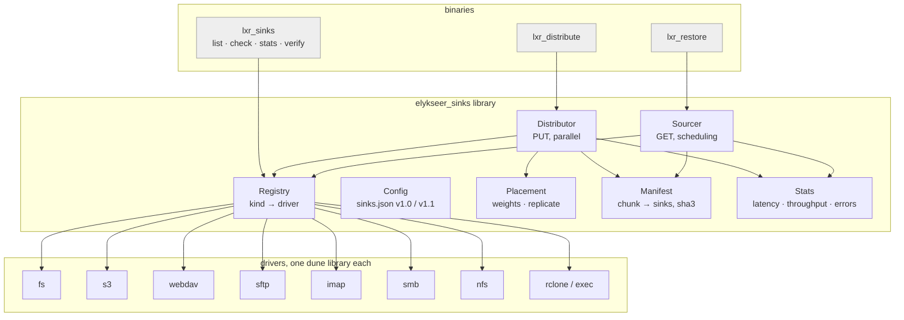

[Content](00_Content.md)

# Sinks and sources — plan

Status: **proposal**. This document plans (1) moving chunk distribution out of
`bin/lxr_distribute.ml` into a library with an abstract sink interface, so new storage backends
(SFTP, WebDAV, IMAP, NFS, SMB, …) plug in easily, and (2) the reverse direction: **sourcing**
chunks from several places, with a notion of access latency and transfer speed that is measured
at run time so faster sources get priority.

---

## 1. Current state

| piece | where | what it does |
|---|---|---|
| sink model | `theories/Distribution.v` | `Module Type SINK` (`init`, `push`, `pull`, `list_n`), `FSSink`, `S3Sink`, closed variant `sink_type = S3 \| FS` |
| placement | `Distribution.enumerate_chunk_paths`, `distribute_by_weight` | weights per sink, taken in order from the chunk list (repeated, so weights summing to more than `n` replicate chunks) |
| extraction | `theories/MakeML.v` (`s3push`, `fspull`, …) | **stubs** that only print — the Coq SINK operations are not used |
| configuration | `elykseer-utils/sinkconfig.ml`, `sinkcheck.ml`, `sinks.json` | JSON → `Distribution.sink_type option`; secret resolution via `*-env`, https enforcement, file mode check |
| I/O | `bin/lxr_distribute.ml` | `put_chunk_s3`, `get_chunk_s3`, `put_chunk_fs`, `get_chunk_fs`, sequential `Lwt_list.mapi_s`, integer result codes |

Problems this plan addresses:

1. **All I/O lives in a binary.** Nothing else (e.g. `lxr_restore`, the `AssemblyCache`) can
   push or pull chunks.
2. **Closed set of sinks.** Adding one means touching the Coq variant `sink_type`,
   `sinkconfig.ml` and the binary's `match`.
3. **GET relies on the same weights as PUT.** No record exists of which sink holds which chunk;
   restoring requires repeating the exact weights and sink order used at distribution time.
4. **Sequential transfers**, one sink after the other, one chunk after the other.
5. **Magic integer result codes** (`1`, `0`, `200..299`, negative curl codes).
6. **Remote key depends on the local directory name:** `mk_valid_bucket_path` keeps the last
   three path components of `<path_chunks>/<subd>/<cid>.lxr`, i.e. includes the basename of
   `path_chunks`.
7. **No per-chunk integrity:** a chunk is only verified indirectly when the whole assembly fails
   AES-GCM authentication — a corrupt chunk from one sink cannot be attributed or replaced
   selectively.

Constraints to keep:

* Chunk names are `SHA3-256(my_id ‖ cid ‖ aid)` (`chunk_identifier` in `MakeML.v`): sinks never
  learn the assembly id or chunk order. Nothing in this plan may leak them to a sink.
* An assembly needs **all `n` chunks** to decrypt.
* Existing `sinks.json` files (version `1.0.0`) and existing remote layouts must keep working.

---

## 2. Target architecture



* **`elykseer_sinks`** (new dune library, `elykseer-sinks/`): interface, registry, config,
  placement, manifest, distributor, sourcer, stats. Depends on `lwt`, `yojson`,
  `elykseer_utils` — **not** on curl or ssh.
* **Drivers** as separate libraries (`elykseer_sink_fs`, `elykseer_sink_s3`, …) so the
  dependency footprint is opt-in. Each registers itself at link time.
* **Coq** keeps the pure parts (§7); I/O stays in OCaml.

---

## 3. The sink interface

### 3.1 Keys

```ocaml
(* a chunk key, independent of the local chunk directory *)
type key = private string          (* "<subd>/<cident>.lxr" *)
val key_of_path : chunkpath:string -> string -> key
val path_of_key : chunkpath:string -> key -> string
```

Drivers map a key into their own namespace (bucket prefix, directory, mailbox, …). A per-sink
option `legacy-key-prefix` reproduces today's third path component, so existing remotes stay
readable (problem 6).

### 3.2 Module type

```ocaml
(* elykseer-sinks/sink_intf.ml *)
type error =
  | Not_found
  | Exists
  | Auth of string
  | Transient of string          (* retry may succeed: timeouts, 5xx, connection reset *)
  | Permanent of string          (* configuration, 4xx, permission *)
  | Size_mismatch of int

type put_result = Stored | Already_present
type caps = {
  can_list   : bool;
  can_delete : bool;
  can_head   : bool;              (* cheap existence check *)
  atomic_put : bool;              (* no partial objects visible *)
  max_parallel : int;             (* driver's own upper bound *)
}

type hints = {                    (* priors for the scheduler, from config or driver defaults *)
  latency_ms     : float;
  bandwidth_mbps : float;
}

module type SINK = sig
  val kind : string                                        (* "S3", "FS", "SFTP", … *)
  type config
  type t

  val of_json  : insecure:bool -> name:string ->
                 credentials:Yojson.Basic.t -> access:Yojson.Basic.t -> (config, string) result
  val default_hints : config -> hints
  val describe : config -> string                          (* no secrets *)

  val connect  : config -> (t, error) result Lwt.t
  val close    : t -> unit Lwt.t
  val caps     : t -> caps

  val put      : t -> key -> Cstdio.File.Buffer.ta -> (put_result, error) result Lwt.t
  val get      : t -> key -> (Cstdio.File.Buffer.ta, error) result Lwt.t
  val exists   : t -> key -> (bool, error) result Lwt.t
  val delete   : t -> key -> (unit, error) result Lwt.t   (* Permanent "unsupported" if not caps.can_delete *)
  val list     : t -> ?prefix:string -> unit -> key Lwt_stream.t
end
```

Rules every driver follows:

* `put` never overwrites: an existing object yields `Already_present` (today's behaviour).
* `put` is **atomic** where possible (temp name + rename for FS/SFTP/SMB/NFS, single PUT for
  S3/WebDAV); otherwise a `get` after `put` verifies length.
* `get` returns exactly 262 144 bytes or `Size_mismatch`.
* Errors are classified as `Transient` or `Permanent`; only the former is retried.
* Secrets come only from `Sinkcheck.resolve_secret` (`*-env` first), never logged by
  `describe`.

### 3.3 Registry

```ocaml
(* elykseer-sinks/registry.ml *)
type driver = (module Sink_intf.SINK)
val register : driver -> unit
val find     : string -> driver option            (* by kind *)
val kinds    : unit -> string list

(* a configured, connected sink, type-erased for the distributor/sourcer *)
type sink
val name    : sink -> string
val kind    : sink -> string
val hints   : sink -> Sink_intf.hints
val put     : sink -> key -> buffer -> (put_result, error) result Lwt.t
val get     : sink -> key -> (buffer, error) result Lwt.t
val exists  : sink -> key -> (bool, error) result Lwt.t
```

Each driver library ends with `let () = Registry.register (module S3_sink)`; binaries link the
drivers they want (`-linkall`). Optional later: out-of-tree drivers loaded with `Dynlink`
(`.cmxs`) from a trusted directory — the same pattern as the accelerator plug-ins in
[10_GPU_AssemblyCache](10_GPU_AssemblyCache.md#7-plug-in-interface-and-hardware-probing).

---

## 4. Drivers

`ezcurl`/`ocurl` is already a dependency, and libcurl speaks HTTP(S), SFTP, SCP, SMB, IMAP(S),
FTP(S). Most new sinks can therefore reuse one transport.

| driver | transport | key mapping | notes | phase |
|---|---|---|---|---|
| **FS** | local file API | `<basepath>/<key>` | also covers *mounted* NFS/SMB/USB; atomic via temp + rename; existing | 1 (move) |
| **S3** | curl + SigV4 | `/<prefix>/<key>` | existing; also Backblaze B2, Wasabi, GCS interop, MinIO | 1 (move) |
| **WebDAV** | curl: `PUT`, `GET`, `HEAD`, `MKCOL`, `PROPFIND` | `<url>/<key>` | Nextcloud/ownCloud, Apache mod_dav; create collections on demand | 2 |
| **SFTP** | curl `sftp://` (libssh2) | `<path>/<key>` | key-based auth; `known_hosts` required unless `--insecure`; rename for atomicity | 2 |
| **IMAP** | curl `imaps://`: `APPEND`, `UID SEARCH SUBJECT`, `UID FETCH` | one message per chunk in a mailbox, subject = key, chunk as base64 attachment (≈ 350 KiB) | slow, but free and replicated by mail providers; mailbox size quotas | 3 |
| **SMB** | curl `smb://` or libsmb2 | `\\share\path\key` | curl's SMB is SMBv1 only → prefer libsmb2 bindings or a mount + FS | 3 |
| **NFS** | libnfs bindings, or mount + FS | `<export>/<key>` | the mount route needs no code | 3 |
| **rclone / exec** | subprocess `rclone rcat` / `rclone cat` / `rclone lsf` | `<remote>:<path>/<key>` | instant coverage of ~70 providers (Azure, Drive, Dropbox, …); one process per transfer, or `rclone rcd` HTTP API | 2 |
| **mock** | in memory | – | configurable latency, bandwidth, failure rate; for tests | 1 |

---

## 5. Distribution (PUT)

### 5.1 Placement

```ocaml
type policy =
  | Weights   of int list          (* today: ordered, contiguous slices; sum > n replicates *)
  | Replicate of int               (* every chunk on k sinks, spread round-robin by weight *)
val place : policy -> sinks:sink list -> keys:key list -> (key * sink list) list
```

`Weights` is exactly `Distribution.distribute_by_weight` (kept in Coq, §7) so existing scripts
produce the same layout. `Replicate k` is the recommended default for new setups: losing one sink
must not lose an assembly, because every chunk is required.

### 5.2 Manifest

After every successful `put` the distributor records

```
chunk key → [ (sink name, stored_at, size) … ], sha3_256(ciphertext chunk)
```

* Stored locally in `path_db` next to the other relations (`relkeys`, `relfiles`), as a new
  relation **`relchunks`**, keyed by chunk key, so it never contains the `aid` in clear on the
  sink side. Locally it may carry the `aid` for convenience — `path_db` is already sensitive.
* The SHA3 of the *encrypted* chunk is computed once at `Assembly.extract` time (or at first
  distribution) and allows **per-chunk verification** of anything fetched from a source
  (problem 7).
* A copy of the manifest can itself be distributed (encrypted with the user's key) so a restore
  on a new machine knows where chunks are.

### 5.3 Execution

* All sinks in parallel; per sink at most `limits.concurrency` transfers in flight
  (`Lwt_pool` / semaphore), optional `limits.bandwidth` token bucket.
* Retries with exponential backoff and jitter for `Transient` errors, max attempts configurable.
* Every transfer feeds the statistics (§6.2), so upload speeds are learned too.
* Result per chunk: `Stored | Already_present | Failed of error`; summary per sink; exit codes
  of `lxr_distribute` stay as documented in [09_Operations](09_Operations.md).

---

## 6. Sourcing (GET)

### 6.1 Which sources hold which chunk

1. **Manifest** (`relchunks`) — authoritative when present.
2. **Weights replay** — when started with the old `-d GET <weights>` arguments, compute the same
   placement as before (backward compatibility).
3. **Discovery** — otherwise ask sources with `exists` (cheap `HEAD` where `caps.can_head`) in
   order of expected speed, and record answers in the manifest.

The local chunk directory (`path_chunks`) is itself a source (kind `FS`, highest prior), so
`Assembly.recall` and the sourcer use the same model.

### 6.2 Measuring speed

For each source keep, per direction:

| statistic | how | use |
|---|---|---|
| `lat` — time to first byte | EWMA, α = 0.2 | access cost |
| `bw` — bytes / transfer time after first byte | EWMA, α = 0.2 | transfer cost |
| `p95` of total time | streaming quantile (P² algorithm) | hedging threshold |
| success rate, consecutive failures | counters | penalty, circuit breaker |
| in-flight transfers | gauge | queueing |
| sample count, last update | counters | confidence, decay |

* **Priors:** `hints` from the configuration (`"hints": {"latency_ms": …, "bandwidth_mbps": …}`)
  or the driver defaults (e.g. FS 0.1 ms / 1000 MB/s, S3 remote 50 ms / 50 MB/s, SFTP 30 ms /
  30 MB/s, IMAP 300 ms / 5 MB/s). A prior counts as a few pseudo-samples so measurements take
  over quickly.
* **Persistence:** statistics are saved in `path_db` (`sourcestats.json`) at the end of a run and
  loaded at start with decay by age, so the second restore already knows the fast sources.
* **Decay:** samples older than a configurable half-life (default 7 days) weigh less; network
  conditions change.

### 6.3 Choosing a source per chunk

Expected completion time of chunk `c` on source `s`:

```
T(s) = wait(s) + lat(s) + 262144 / bw(s)
wait(s) = max(0, inflight(s) − concurrency(s) + 1) · (lat(s) + 262144 / bw(s)) / concurrency(s)
score(s) = T(s) · (1 + penalty(s))         penalty grows with recent failures
```

Algorithm for one assembly (all `n` chunks needed):

1. For every chunk, candidates = sources holding it, minus open circuit breakers.
2. **Greedy earliest-finish-time:** repeatedly assign the chunk with the fewest candidates first
   (scarcest first), to the source with the smallest `score` taking already assigned work into
   account. This spreads load over several fast sources instead of piling everything on the
   single fastest one.
3. **Exploration:** with probability ε (default 5 %), or when a source has < 3 samples, assign a
   chunk to a non-best candidate so estimates stay fresh.
4. **Hedging:** if a transfer runs longer than `2 · p95(s)`, start the same chunk on the next
   best source; the first verified result wins, the other is cancelled.
5. **Verification:** every fetched chunk is checked against the manifest SHA3 (when known);
   a mismatch marks the copy as bad (counts as failure of that source, logged with sink name and
   key) and the chunk is re-queued to another source.
6. **Circuit breaker:** after `k` consecutive failures (default 3) a source is skipped for a
   back-off interval, then probed with one chunk.

Fetched chunks are written atomically to `path_chunks` (temp + rename, as `get_chunk_s3` already
avoids leaving short chunks behind).

### 6.4 Integration with restore

* **Phase 2:** `lxr_restore --sources sinks.json` — before restoring a file, compute the set of
  `aid`s of its blocks, and let the sourcer fetch missing chunks of those assemblies into
  `path_chunks` (prefetch, in parallel with restoring earlier files). No change to the verified
  code.
* **Phase 4:** hook into `Assembly.recall` itself, so the `AssemblyCache` pulls on demand —
  together with the tiers proposed in
  [10_GPU_AssemblyCache §3.5](10_GPU_AssemblyCache.md#35-tiers) (T2 local, T3 remote sinks).

---

## 7. Coq side

`theories/Distribution.v` changes, kept small:

* **Keep** `enumerate_chunk_paths` and `distribute_by_weight` (pure placement), add
  `replicate_by_weight` with lemmas (every chunk is placed exactly `k` times when `k ≤` number of
  sinks; weights clipped to `n`).
* **Add** the pure selection function of §6.3 with a proof that every chunk with at least one
  candidate is assigned to a candidate that holds it (scores are an axiomatised input).
* **Replace** the closed `sink_type = S3 | FS` and the unused `SINK` push/pull axioms with an
  abstract `Axiom sink_handle : Type`; drivers live in OCaml. The S3/FS records may stay for
  documentation or be dropped. Update `MakeML.v` and `Assumptions.expected` accordingly.

---

## 8. Configuration (`sinks.json` 1.1, backward compatible)

```json
{
  "version": "1.1.0",
  "defaults": { "retries": 4, "concurrency": 4 },
  "sinks": [
    {
      "type": "S3", "name": "s3_aws",
      "credentials": { "access-key-env": "AWS_ACCESS_KEY_ID", "secret-key-env": "AWS_SECRET_ACCESS_KEY" },
      "access": { "bucket": "mybucket", "prefix": "lxr", "host": "mybucket.s3.eu-west-3.amazonaws.com",
                  "port": "443", "protocol": "https", "legacy-key-prefix": "elykseer.chunks" },
      "roles": ["put", "get"],
      "weight": 1,
      "limits": { "concurrency": 8, "bandwidth-mbps": 100 },
      "hints":  { "latency_ms": 40, "bandwidth_mbps": 80 }
    },
    {
      "type": "SFTP", "name": "nas",
      "credentials": { "user": "lxr", "private-key-file": "~/.ssh/lxr_ed25519", "known-hosts": "~/.ssh/known_hosts" },
      "access": { "host": "nas.local", "port": "22", "path": "/volume1/lxr" }
    },
    {
      "type": "IMAP", "name": "mail_archive", "roles": ["put", "get"],
      "credentials": { "user": "me@example.org", "password-env": "LXR_IMAP_PW" },
      "access": { "url": "imaps://imap.example.org", "mailbox": "lxr-chunks" },
      "hints": { "latency_ms": 300, "bandwidth_mbps": 5 }
    }
  ]
}
```

* Unknown `type` → clear error naming the registered kinds (today: silently `None`).
* `Sinkcheck.resolve_secret` generalised to every credential field (`<field>-env`), the
  file-mode check unchanged, `check_protocol` per scheme (`https`, `sftp`, `imaps`, `smb` with
  encryption; plain variants only for local hosts or `--insecure`).
* `roles` lets a sink be source-only (e.g. a read-only mirror) or sink-only.
* CLI weights still override `weight` for compatibility.

---

## 9. Binaries after the move

* **`lxr_distribute`** — thin wrapper: parse arguments, load config, call
  `Distributor.run` / `Sourcer.run`. New options: `--policy weights|replicate:K`, `--parallel N`,
  `--manifest PATH`; `-d GET` without weights uses the manifest.
* **`lxr_sinks`** (new) — `list` (registered kinds, configured sinks), `check` (connect, write /
  read / delete a probe object), `stats` (learned latency and bandwidth per sink), `verify -a
  AID` (all chunks present and hashes match on every sink), `repair -a AID` (re-replicate
  missing copies).
* **`lxr_restore`** — `--sources sinks.json` (§6.4).

---

## 10. Testing

* **mock driver** with configurable latency, bandwidth, error rate: scheduler tests (faster
  sources receive more chunks; exploration keeps estimates alive; hedging wins against a stalled
  source; circuit breaker opens and closes).
* **property tests** (`qcheck`, already used in `test/testPBT.ml`): placement preserves every
  chunk; `Replicate k` yields `k` copies; `Weights` equals the old `distribute_by_weight`; the
  scheduler only picks sources that hold the chunk; every available chunk is fetched exactly
  once (hedging duplicates excluded).
* **driver conformance suite**, run against every driver: put/get roundtrip, `Already_present`
  on second put, `Not_found`, size check, atomicity (no partial object after a killed transfer).
* **integration:** FS in a temp dir always; S3 against MinIO, WebDAV and SFTP against containers
  (the `docker/` directory), IMAP against a Dovecot container — in a separate CI job.
* **compatibility:** a fixture remote layout created by today's `lxr_distribute` must be readable
  with `legacy-key-prefix`.
* Existing tests in `test/testUtils.ml` (Sinkconfig) migrate to the new config module.

---

## 11. Phases

| phase | content | done when |
|---|---|---|
| **1 move** | `elykseer_sinks` library: interface, registry, config (v1.0 + v1.1), typed results; FS and S3 drivers moved from `lxr_distribute.ml`; mock driver; `lxr_distribute` becomes a wrapper; parallel transfers with limits and retries | same behaviour as today, tests green, old scripts unchanged |
| **2 manifest + sourcing** | `relchunks` manifest with chunk SHA3, `Replicate` policy, statistics and scheduler, `lxr_sinks check/stats/verify`, `lxr_restore --sources`; WebDAV, SFTP, rclone drivers | GET without weights; faster sources measurably preferred |
| **3 more sinks** | IMAP, SMB (libsmb2), NFS (libnfs), conformance suite in CI | each driver passes the suite |
| **4 deep integration** | sourcing inside `Assembly.recall`, Coq selection function and lemmas, `repair`, distributed encrypted manifest | restore on a fresh machine with only `sinks.json` + keys |

---

## 12. Open questions

* **Erasure coding** instead of replication (e.g. Reed–Solomon over the `n` chunks, any `n` of
  `n + m` suffice) would cut storage overhead for the same durability. It changes the archive
  format, so it is out of scope here, but the placement interface (`key → sink list`) and the
  sourcer ("need any `n` of these") are designed so it can be added.
* Should the manifest live in the existing relation store (irmin-git, like `relkeys`) or as a
  separate file? Using the store gives history and the same backup story.
* Upload scheduling by measured speed: weights stay a user decision; `lxr_sinks stats` can
  *suggest* weights from measured upload bandwidth.
* Rate limits and costs of cloud providers (requests per second, egress fees) — a `cost` hint per
  sink could be added to the score so cheap sources are preferred when speed is similar.
