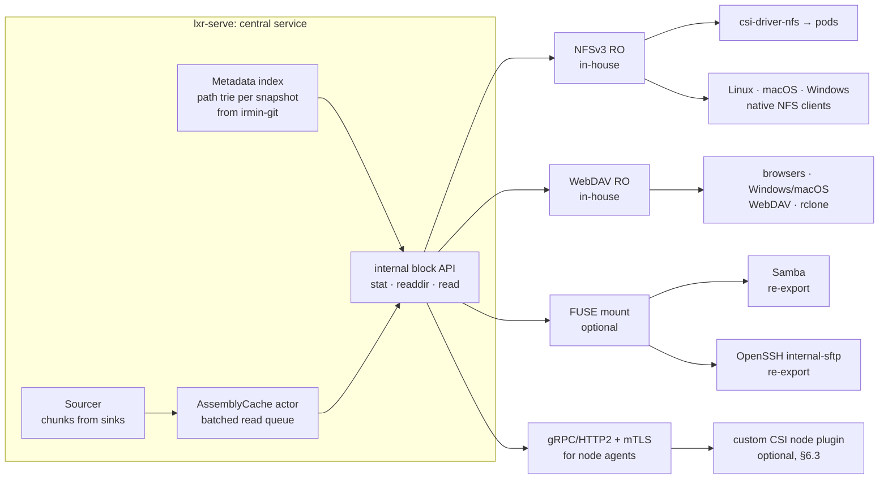

[Content](00_Content.md)

# Serving the AssemblyCache: network protocols, mounts, Kubernetes

Status: **evaluation / proposal**. This document asks whether the `AssemblyCache` can become a
central service that clients reach over SMB, SFTP, WebDAV or NFS, or mount as a filesystem, up
to a Kubernetes CSI driver. It covers what exists, what is missing, how much work each route is,
what could be reused, and what the licences of reusable parts mean.

Related plans: [10 GPU AssemblyCache](10_GPU_AssemblyCache.md) (cache tiers),
[11 Sinks and sources](11_Sinks_and_Sources.md) (fetching chunks from several places).

---

## 0. Summary

* **Possible: yes.** Everything a read-only filesystem needs is already in the metadata: file
  names, sizes, owner, permissions, modification time, a whole-file checksum, and for every
  32 KiB block its `(aid, apos, size, sha3)`. The `AssemblyCache` already serves exactly the
  operation a filesystem read needs: "give me `len` bytes at `apos` of assembly `aid`".
* **What's missing:** a *directory index* (the store is keyed by a hash of the file name), a
  *snapshot* notion, a *long-running cache service* with concurrent clients, and protocol
  front ends.
* **Main finding:** you do **not** need to write a CSI driver to reach pods. If the service speaks
  **NFSv3 (read-only)**, the existing, Apache-2.0 licensed `csi-driver-nfs` mounts it into any
  pod, and Linux, macOS and Windows can all mount it without FUSE. One protocol written in-house
  gets most of the reach.
* **Recommended order:**
  1. a metadata index and cache service with a small internal API;
  2. a **read-only NFSv3** server, written from scratch (licence-independent, about 4–6 weeks);
  3. **WebDAV** read-only (2 weeks; browsers, Windows/macOS clients, rclone);
  4. FUSE as an optional local mount;
  5. SMB/SFTP by **re-exporting** a mount with Samba/OpenSSH as separate processes — never
     implemented in-house;
  6. a **custom CSI** driver only if per-pod credentials, encrypted transport to the node or
     dynamic provisioning are required.
* **Writing** through the mount (backup into a mounted folder) is possible with *write-once,
  commit-on-close* semantics, but it is a second project. Start read-only.

---

## 1. What the metadata gives us today

| need of a filesystem | available | where |
|---|---|---|
| file content | blocks `(blockaid, blockapos, blocksize, filepos, bchecksum)` | `Relfiles.relation.rfbs`, `Assembly.blockinformation` |
| size, owner, mode, mtime | `fsize`, `fowner`, `fpermissions`, `fmodified` | `Filesupport.fileinformation` |
| integrity | per block SHA3 + whole-file `fchecksum` | idem |
| file name | `fname` (full path as backed up) | stored *inside* the JSON value |
| lookup key | `fhash = SHA3(fname ‖ my_id)` | `bin/lxr_restore.ml`, `Relfiles.repo_path` |
| keys | `aid → keyinformation` | `Relkeys` |
| storage | irmin-git bare repository at `path_db`, path `[my_id; "relfiles"; d1; fhash]` | `elykseer-utils/relfiles.ml` |
| history | every `Relfiles.add` is a git commit | irmin |

What is missing for a filesystem view:

1. **Directory structure.** Directories exist only implicitly in `fname`. Listing `/home/a/`
   needs a scan of all hashes (`Relfiles.hashes`) and reading each JSON value: fine once at
   start, too slow per `readdir`. → build a **path index** (§3.1).
2. **Snapshots.** Commits happen per file, not per backup run. → tag one commit per run
   (`snapshot/<timestamp>`), so a mount can show `/.snapshots/<run>/…` and a stable "latest".
3. **Symlinks, empty directories, xattrs, hard links** are not recorded. They show up as
   absent, or the backup side must learn to record them (format extension, later).
4. **Chunks need to be local** (`path_chunks`) for `Assembly.recall`. → the sourcing plan
   ([11](11_Sinks_and_Sources.md)) fetches them on demand.

---

## 2. Target architecture



### 2.1 The internal API (the only thing protocol front ends talk to)

```ocaml
type snapshot = string                          (* tag or commit id *)
type node_id  = string                          (* fhash for files, SHA3(path) for directories *)

type attr = { kind : [`File | `Dir]; size : int; mode : int; owner : string;
              mtime : float; node : node_id }

val snapshots : unit -> snapshot list Lwt.t
val lookup    : snapshot -> parent:node_id -> string -> attr option Lwt.t
val getattr   : snapshot -> node_id -> attr option Lwt.t
val readdir   : snapshot -> node_id -> ?cookie:int -> int -> ((string * attr) list * int option) Lwt.t
val read      : snapshot -> node_id -> off:int -> len:int -> (Bigstring.t, error) result Lwt.t
```

* **Stable handles:** `node_id` is derived from the content-independent hashes, so NFS file
  handles stay valid across server restarts (NFS requires this); the snapshot id is part of the
  handle.
* `read` maps `[off, off+len)` to the blocks sorted by `filepos` (binary search), asks the cache
  for each `(aid, apos, size)`, checks the block SHA3, and returns the slice. Read-ahead of the
  next blocks of the same file; requests from all clients are grouped by `aid` (this matches the
  existing `enqueue_read_request` / `iterate_read_queue` design in `theories/AssemblyCache.v`).

### 2.2 The cache as a service

Today the `AssemblyCache` is a pure value threaded through one process run. As a service:

* **one owner** (an Lwt "actor", or a dedicated OCaml 5 domain) holds the `assemblycache` value;
  front ends send requests over a channel; the owner drains the queue per `aid` in batches;
* a small LRU of decrypted *blocks* in front of it (hot files, directory read patterns);
* `acsize` and memory budget from configuration; GPU tier optional ([10](10_GPU_AssemblyCache.md));
* missing chunks are fetched through the sourcer ([11](11_Sinks_and_Sources.md)), so the service
  needs only `path_db`, keys and `sinks.json`, not a full local chunk store;
* metrics (hit rate, misses, bytes served, latency) and health endpoints for Kubernetes.

The verified Coq code does not change in this step; the service wraps the extracted
`AssemblyCache` functions.

---

## 3. Pieces and effort

Effort in person-weeks for one developer who knows the code base; read-only unless stated.

### 3.1 Common foundation (needed for every route)

| piece | work | effort |
|---|---|---|
| path index | scan `relfiles` of a `my_id` at a snapshot, build a trie (path → node, children sorted); incremental update with an irmin/git diff between commits; persisted cache file | 2–3 w |
| snapshots | tag per backup run in `lxr_backup`; list/resolve tags | 0.5 w |
| cache service | actor around `AssemblyCache`, batched reads, block LRU, read-ahead, config, metrics | 3–4 w |
| block API + auth | internal API (above), tenant = `my_id`, ACL per snapshot | 1–2 w |
| **subtotal** | | **≈ 7–10 w** |

### 3.2 Protocol front ends

| front end | from scratch? | effort | reach | notes |
|---|---|---|---|---|
| **NFSv3 read-only** | yes — ONC-RPC/XDR, MOUNT, NFS procedures `GETATTR LOOKUP ACCESS READ READDIR(PLUS) FSSTAT FSINFO PATHCONF`, no locking | **4–6 w** | Linux, macOS, Windows (NFS client feature), **K8s via csi-driver-nfs** | stateless, so a good match for a read-only archive; one port with `nolock`, plus a fixed mountd port |
| NFSv4.1 | possible, much larger (sessions, state, compound ops) | 12+ w | idem, single port | only if v3 is ruled out |
| **WebDAV read-only** | yes — HTTP `GET` with ranges, `HEAD`, `PROPFIND`, `OPTIONS` | **2 w** | browsers, Windows Explorer, macOS Finder, rclone, `davfs2` | TLS for free with the HTTP stack; good for humans |
| WebDAV writable | `PUT`/`MKCOL`/`MOVE`/`LOCK` | +2–3 w | | write-once semantics, §5 |
| **9P2000.L** | small protocol | 2 w | Linux kernel `v9fs`, QEMU/VMs, WSL | a niche, but a cheap and clean Linux mount without FUSE |
| **FUSE** (Linux) | C stubs over libfuse 3 low-level API, or a binding | 2–3 w | local mount | needs `/dev/fuse` and `SYS_ADMIN` in containers |
| FUSE macOS / Windows | macFUSE / FUSE-T / WinFsp | +2–4 w | | licensing issues, §4; NFS/WebDAV mounts are the simpler choice there |
| **S3 GET/LIST** gateway | HTTP, SigV4 verification | 2–3 w | any S3 tool, Mountpoint-for-S3 CSI | fits `ReadOnlyMany` data sets |
| **SMB2/3** | **no** — very large protocol (dialects, signing, encryption, oplocks, DFS) | months | | re-export a mount with Samba (separate process) |
| **SFTP** | possible over an SSH library, but the SSH part is the risk | 4+ w | | re-export a mount with OpenSSH `internal-sftp` (separate process) |

### 3.3 Kubernetes

| route | effort | what you get |
|---|---|---|
| **A. init container** running `lxr_restore` into an `emptyDir` | days | works today; full copy at pod start, no sharing |
| **B. central `lxr-serve` + NFS + csi-driver-nfs** | Helm chart and docs: 1–2 w (after NFS) | `PersistentVolume` (static) per snapshot/subtree, `ReadOnlyMany`, shared hot cache across pods |
| **C. volume populator** (`dataSourceRef` → restore a snapshot into a fresh PVC) | 3–4 w | real writable copies for workloads that need them; uses the upstream `lib-volume-populator` |
| **D. custom CSI driver** (node plugin as DaemonSet, FUSE or NFS-loopback per volume, gRPC + mTLS to the service; controller for provisioning from a `StorageClass`) | 6–10 w | per-volume credentials and tenant isolation, encrypted traffic to the node, `VolumeSnapshot` mapping |

**Is a CSI driver needed?** Usually not. Route B gives pods a mounted, read-only, shared
archive with only standard components. A custom CSI driver is worth it when one of these is a
hard requirement:

* plaintext must not cross the pod network unencrypted: NFSv3 has no transport encryption.
  RPC-over-TLS (RFC 9289; Linux client ≥ 6.5 with `tlshd`) is an alternative to evaluate first;
* per-workload credentials (a pod may see only its own `my_id`/subtree);
* dynamic provisioning from a `StorageClass` with parameters (`snapshot`, `path`, `identity`).

Reference designs of the same shape (central metadata + node agents + CSI): JuiceFS CSI,
SeaweedFS CSI, Mountpoint for S3 CSI. They are useful for structure; the code is not needed.

### 3.4 Totals

| scope | effort |
|---|---|
| foundation + NFSv3 RO + Helm chart (route B) | **≈ 13–18 w** |
| + WebDAV RO | + 2 w |
| + FUSE (Linux) | + 2–3 w |
| + SMB/SFTP re-export (container images, docs) | + 1 w |
| + volume populator | + 3–4 w |
| + custom CSI | + 6–10 w |
| + write support (§5) | + 6–8 w |

---

## 4. Reuse versus from scratch (licences)

eLyKseeR is **GPL-3.0-or-later**. Three cases have to be kept apart:

1. **Separate processes** (Samba, OpenSSH, rclone, csi-driver-nfs, kernel clients) talk to us
   over a protocol. This is no derivative work: any licence is fine, and this keeps licence
   independence.
2. **Linked libraries:** the licence must be compatible with GPL-3 today, *and* must not block a
   future relicensing (e.g. dual licence, or a permissive core) if that is a goal. Permissive
   (MIT/BSD/ISC/Apache-2.0) and LGPL keep both options; GPL-only libraries lock in the GPL.
3. **Own code:** full freedom; the cost is the effort in §3.

| candidate | licence (verify before use) | how it would be used | assessment |
|---|---|---|---|
| libfuse 3 | LGPL-2.1 (library) | link, own thin C stubs | OK; write our own stubs instead of a GPL binding |
| ocamlfuse | GPL (check version) | OCaml binding | ❌ excluded by the licence-independence decision → own stubs |
| macFUSE | closed-source kernel extension, redistribution terms | macOS FUSE | avoid; mount our NFS/WebDAV server instead (built into macOS) |
| FUSE-T | proprietary freeware (NFS-loopback based) | macOS FUSE | avoid for the same reason |
| WinFsp | GPL-3 with FLOSS exception | Windows FUSE | not for a proprietary product (exception covers FLOSS only); use the built-in NFS/WebDAV clients |
| ocaml-9p (Mirage) | ISC | 9P server | good fit, permissive, OCaml-native |
| cohttp / Dream / h2 | ISC / MIT / BSD | HTTP for WebDAV, S3 gateway, health, gRPC | good fit |
| ocaml-grpc | BSD-3 | service ↔ node agent | good fit |
| go-nfs (willscott) | Apache-2.0 | NFSv3 server in Go, backend via gRPC to us | fast start, but a second language and an extra hop |
| nfsserve (Rust) | BSD-3 | NFSv3 server in Rust, backend via gRPC/FFI | same; good if a Rust component exists anyway (see [10 §8.3](10_GPU_AssemblyCache.md#83-rust)) |
| nfs-ganesha | LGPL-3 | user-space NFS server with an FSAL plug-in | complete NFSv3/4/4.1 with Kerberos; FSAL in C linked into Ganesha — heavy, but the fastest way to NFSv4 + krb5p |
| Samba | GPL-3 | separate process re-exporting a FUSE mount | the only sensible SMB route |
| OpenSSH | BSD-style | `internal-sftp` re-exporting a FUSE mount | the only sensible SFTP route |
| rclone (`serve nfs/webdav/sftp/s3/ftp`) | MIT | separate process over our WebDAV/S3 front end | gives every other protocol from one in-house front end |
| csi-driver-nfs, csi-driver-smb, lib-volume-populator, CSI spec | Apache-2.0 | deployed as is / as library for D | good fit |

**Recommendation:**

* Write in-house what is **small and central**: index, cache service, NFSv3 read-only, WebDAV
  read-only. That is licence-independent and in OCaml next to the verified core.
* **Link only permissive or LGPL** libraries (libfuse via own stubs, ocaml-9p, cohttp/h2,
  ocaml-grpc).
* Get the **large protocols** (SMB, SFTP, NFSv4 + Kerberos) from **separate processes**
  (Samba, OpenSSH, nfs-ganesha), so they impose nothing on the code base.
* rclone in front of the WebDAV server is an inexpensive "everything else" adapter.

---

## 5. Writing through the mount (later)

A backup is append-only: a file becomes blocks in assemblies plus a `relfiles` entry. Mapping
POSIX writes onto that:

* **write-once, commit-on-close:** `create` + sequential `write` are buffered (spooled to a temp
  file), and on `close` the file runs through `Processor.file_backup`, which adds a new
  `relfiles` version. This covers WebDAV `PUT`, SFTP uploads, `cp` into a mount, and
  `rsync --inplace=no`.
* **random writes and overwrites:** copy-on-write of the whole file (read old version, apply
  writes, back up again on close). Correct but expensive for large files, so it should be limited
  by size.
* `rename`/`unlink` become metadata operations (new entry or tombstone) in the *next* snapshot;
  old snapshots stay immutable.
* Single writer per `my_id` (the writable assembly is one per cache), so clients are serialised
  through the cache actor.
* Effort: 6–8 weeks including tests. Read-only covers restore, browsing, auditing and data
  sharing to pods, which are the main use cases.

---

## 6. Security

* The service holds **all keys** (`relkeys`) and **plaintext file names** of the identities it
  serves. That makes it a high-value target:
  * run one service **per namespace/tenant** (`my_id`), not one for the whole cluster;
  * keys from a Kubernetes `Secret` or an external KMS/Vault, never baked into images; metadata
    and chunks on volumes the service alone can read;
  * restrict access with `NetworkPolicy` (only the node/CSI or the consuming pods may reach the
    NFS/WebDAV ports).
* **Transport:** WebDAV/S3/gRPC with TLS (mTLS for agents). NFSv3 is plaintext and AUTH_SYS
  (UID-based): acceptable on a node-local or tightly policed network; otherwise use RPC-over-TLS,
  nfs-ganesha with krb5p, or a CSI node agent that speaks mTLS to the service and serves the
  mount locally (route D).
* **Read-only exports** by default; snapshots are immutable by construction.
* **Path traversal:** names come from backed-up `fname`s; reuse the checks of
  `Pathutils.restore_relpath` / `contained_target` (`bin/lxr_restore.ml`) when building the
  index.
* **Resource limits:** a client reading many files across many assemblies can force constant
  decryption (cache thrash). Per-client rate limits and an admission queue in the cache actor
  protect against this.
* FUSE in pods needs `/dev/fuse` and `SYS_ADMIN` (or a privileged CSI node plugin). Route B
  avoids privileged pods altogether, because the kubelet mounts NFS.

---

## 7. Phases

| phase | content | result |
|---|---|---|
| **0** | Helm chart with an init container running `lxr_restore` | pods get data now (copy) |
| **1** | path index, snapshot tags, cache service, block API, metrics | `lxr-serve` with an HTTP debug API (`stat`, `ls`, `cat`) |
| **2** | NFSv3 read-only; Helm chart with csi-driver-nfs `PersistentVolume`s | archive mounted read-only into pods; native mounts on Linux/macOS/Windows |
| **3** | WebDAV read-only; rclone/Samba/OpenSSH re-export images | browser access, SMB and SFTP without own protocol code |
| **4** | FUSE (Linux) via own libfuse stubs; 9P optional | local mounts on developer machines |
| **5** | volume populator, or a custom CSI driver if §3.3's requirements apply | `PVC` from a snapshot; per-pod isolation |
| **6** | write-once, commit-on-close (WebDAV `PUT`, FUSE) | backups by copying into a mount |

---

## 8. Testing

* **index:** property tests (`qcheck`) — every backed-up `fname` appears exactly once under its
  path; `readdir` of each directory equals the set of direct children; snapshot diffing equals a
  rebuild from scratch.
* **read path:** random `(off, len)` reads compared byte for byte with `lxr_restore` output,
  including block boundaries, last partial block and zero-length files.
* **protocol conformance:** NFS with the Linux kernel client in CI (mount, `find`, `md5sum`,
  `fio` random reads), plus `pynfs`-style tests for the v3 procedures used; WebDAV with `litmus`
  and `rclone check`; FUSE with `pjdfstest` (read-only subset).
* **Kubernetes:** `kind` cluster in CI, csi-driver-nfs deployed, a pod mounts a snapshot and
  verifies checksums.
* **load:** many concurrent readers over many assemblies; watch the cache hit rate and the
  decryption rate.

---

## 9. Open questions

* ~~Licence independence or only GPL compatibility?~~ **Decided: licence independence** (share
  code and binaries, build a business on it). No third-party GPL library is linked; LGPL only
  dynamically; GPL programs only as separate processes. See the
  [licence audit](13_License_Audit.md).
* One service per `my_id`, or one per namespace serving several identities with ACLs?
* Do we need symlinks, empty directories and xattrs? They need a format extension on the backup
  side.
* Should snapshots be explicit backup-run tags (proposed) or every commit?
* For pods, is NFSv3 plaintext on a policed network acceptable, or is encrypted transport to the
  node a requirement (which leads to route D)?
